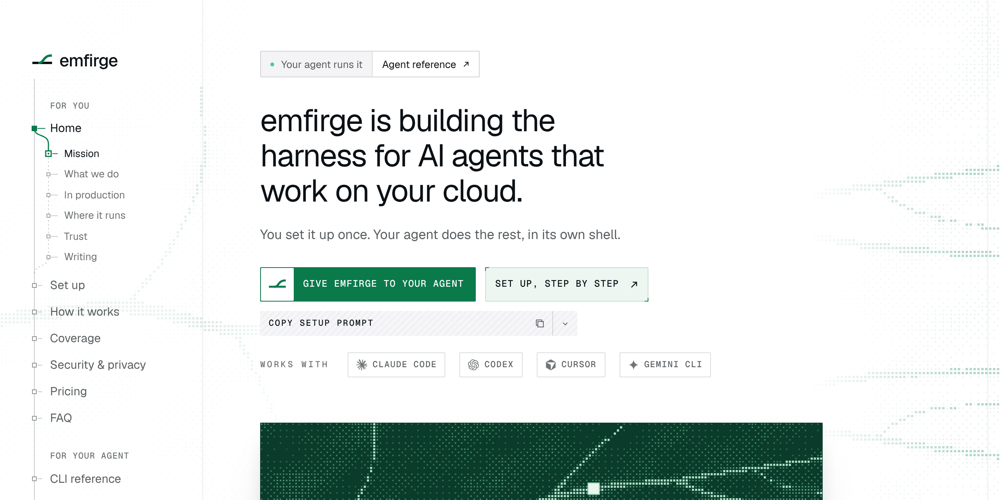

<div align="center">

# emfirge

### The harness for AI agents that work on your cloud.

You set it up once. Your agent does the rest, in its own shell.

[Website](https://emfirge.cloud) · [Set up](https://emfirge.cloud/quickstart/) · [How it works](https://emfirge.cloud/how-it-works/) · [CLI reference](https://emfirge.cloud/cli.md) · [llms.txt](https://emfirge.cloud/llms.txt)

<a href="https://emfirge.cloud"></a>

</div>

---

## People don't use emfirge. Their agent does.

Agents can already write the Terraform and run the AWS CLI. What they can't do is see what a change will break. Emfirge gives them that: a true model of your AWS, a **branch** of it to try a change on, and **six checks** that say what the change does, before anything is real.

Emfirge supplies the truth. Your agent supplies the intelligence. There is no AI inside emfirge: the same branch always gets the same answer, and it never writes to your cloud.

```text
you    ▸ Clean up the unused databases in us-east-1.

agent  ▸ I tried it on a branch first. Verdict: block.
         data: orders-db is deleted and has no recovery point
               (data_store_deleted_no_recovery_point)
         availability: 2 services depend on orders-db

         On a second branch, deleting only legacy-reports-db passes.
         Shall I apply that one?
```

<sub>Simplified. The reason codes are the engine's real ones.</sub>

## Give emfirge to your agent

Paste this into an agent that can run commands (Claude Code, Codex, Cursor, Gemini CLI). It needs Node.js 20 or later.

```text
Set up emfirge for my AWS account and use it for every AWS change from now on.
emfirge is a CLI. Run it as `npx -y emfirge <command>` (Node.js 20 or later). Run `npx -y emfirge guide` first; the full reference is https://emfirge.cloud/cli.md.

1. Run `login`. It opens my browser so I can sign in with GitHub or Google. If it does not open, show me the address it prints, then wait for me.
2. Run `connect` and show me the link it prints. I will create the read-only role and send you the role ARN. Ask me which AWS region to use.
3. Run `context --refresh --role-arn ARN --region REGION`, then `context inventory`. Keep the role ARN: later steps need it.

Before any AWS change: open a branch (`branch open`), try the change on it (`try`), and read `check`. Never apply a change that did not pass. If it fails, fix your plan and try again on the branch. Ask me before `check --policy` or `check --evidence`: they cost money. When a change passes, apply it with your own access, run `report`, and tell me what changed.
```

You approve two things: the browser sign-in, and one click in AWS that creates a **read-only role** (delete the stack to revoke it). Running in the cloud or CI? Use an API key instead of the browser: see [Set up](https://emfirge.cloud/quickstart/).

## The loop

`context → branch → try → check → fix → retry → apply → report`

| Verb | What the agent does |
|---|---|
| `context` | Asks what is true: inventory, dependencies, what is reachable, who can access what, cost, what is live |
| `branch` | Opens a copy of live AWS. Fork, roll back, compare, discard. Live never moves |
| `try` | Puts its change on the branch, as typed changes, AWS CLI commands, AWS API calls, a Terraform plan or a CloudFormation change set |
| `check` | Reads six answers with facts, what was checked and what is unknown. `--verdict` gives `pass`, `warn` or `block` |
| `request` | Asks the owner. *Not built yet* |
| `report` | The hand-back of what it applied, bound by hash to the verdict it passed |

The agent applies the change itself, with its own access. Emfirge never does.

## Six checks

Always all six, always in this order. Each one answers with facts and lists what it could not check.

| Check | The question |
|---|---|
| **Data** | Did something that holds data disappear with no recovery point? |
| **Exposure** | Is anything newly reachable from the internet or another account? |
| **Money** | How did the monthly cost change? |
| **Availability** | Did something live traffic depends on break or disappear? |
| **Control** | Did who can do what, or what is logged, change? |
| **Outside world** | Does the change leave the cloud (support cases, emails, domains, schedules)? |

Where a public source exists, the checks use it: AWS's own API models and Price List, [pathfinding.cloud](https://pathfinding.cloud), Prowler and policy_sentry. The same change gives the same verdict whichever way it comes in.

## Rules emfirge keeps

- **Read-only, always.** It reads your account through a role you can revoke. It has no write permission of any kind.
- **Unknown is never safe.** A change emfirge can't model can't `pass`. What it did not check is listed, not hidden.
- **Private by default.** Account IDs and names are swapped for tokens (`S3_001`) on your machine before any model sees them.
- **Facts, not fixes.** Emfirge says what a change does. Your agent decides what to do about it.

Emfirge is a model of your cloud, so `pass` is evidence, not a guarantee. It is advisory: it stops nothing on its own.

## In numbers

| | |
|---|---|
| Agents deleting prod, benchmark | 49 / 49 locked incident tests pass (synthetic accounts) |
| Laws | 89 numbered properties that must always hold ([backend/tests/laws](backend/tests/laws)) |
| Engine tests | 3,274 |
| Resource types a branch can change | 18 ([coverage](https://emfirge.cloud/coverage/)) |
| Privilege-escalation paths checked | 92, from pathfinding.cloud |

## Status

Free while in beta. What works today and what does not is on the site: [coverage](https://emfirge.cloud/coverage/), [pricing](https://emfirge.cloud/pricing/), [FAQ](https://emfirge.cloud/faq/).

<details>
<summary><b>Repository layout and licenses</b></summary>

| Path | What it is | License |
|---|---|---|
| [`backend/`](backend) | The engine: collector, branches, input adapters, the six checks, verdict, hand-back | AGPL-3.0 |
| [`cli/`](cli) | `emfirge`, the CLI on npm | Apache-2.0 |
| [`mcp/`](mcp) | Shared client code and the MCP adapter | Apache-2.0 |
| [`site/`](site) | [emfirge.cloud](https://emfirge.cloud) | AGPL-3.0 |
| [`iam-role.yaml`](iam-role.yaml) | The read-only role | AGPL-3.0 |

</details>

## Built by

Emfirge is designed and built by **Ansh Sonkar** ([@theanshsonkar](https://github.com/theanshsonkar)). Building with AI agents on AWS? Email **[ansh@emfirge.cloud](mailto:ansh@emfirge.cloud)**.

[Contributing](CONTRIBUTING.md) · [Security](SECURITY.md) · [Privacy](PRIVACY.md)
